# 🌳 SombraViva — Infraestrutura Linux (Operating Systems)

> **Global Solution FIAP 2026 · CitizenTech** — Inteligência Climática Urbana em Osasco (SP)
>
> Repositório da disciplina **Operating Systems**: provisionamento **100% automatizado** com Shell Script de uma VM Linux que hospeda a API do SombraViva, com rede, DNS, firewall, serviço systemd, monitoramento com alertas e logs de auditoria.

| | |
|---|---|
| **Grupo** | Douglas dos Santos Melo (RM556439) · Henrique Sanches (RM557959) · João Pedro Kraide Máximo (RM563166) · Matheus Marcelino Dantas da Silva (RM556332) · Nicolas Caciolato Reis (RM556506) |
| **Vídeo (até 7 min)** | _cole aqui o link do YouTube_ |
| **Sistema** | Ubuntu Server 26.04 LTS no VirtualBox 7.2 (também funciona no 24.04) |
| **Aplicação hospedada** | API do SombraViva, do repositório de SOA: <https://github.com/JoaoKraideM/Global-Solution---2-semestre---Cyber-Soa> |
| **Circuito IoT** | <https://github.com/doug-melo/sombraviva-iot> |
| **Comando único** | `sudo ./provision.sh` |

---

## 1. Visão geral

O **SombraViva** monitora ilhas de calor urbanas. Nasceu da retirada das árvores do Calçadão de Osasco: dois sensores ESP32 (simulados no Wokwi) medem temperatura e umidade em uma **zona arborizada** e no **Calçadão sem vegetação**, e enviam as leituras para uma **API REST (FastAPI + MySQL)**.

Neste repositório essa API é hospedada em uma VM Linux configurada **apenas por scripts Bash**:

- **rede, DNS, IP, hostname, fuso e firewall** → `scripts/01_provision_infra.sh`
- **dependências, MySQL, API (systemd) e Nginx** → `scripts/02_provision_app.sh`
- **monitoramento de CPU, memória, disco, API e MySQL** → `scripts/03_monitor.sh`
- **monitor como serviço systemd tolerante a falhas + auditoria** → `scripts/04_setup_monitoring.sh`
- **testes de falha** (kill -9, CPU, disco, MySQL) → `scripts/05_teste_falha.sh`
- **túnel público para o Wokwi** (opcional) → `scripts/06_tunnel.sh`

## 2. Arquitetura

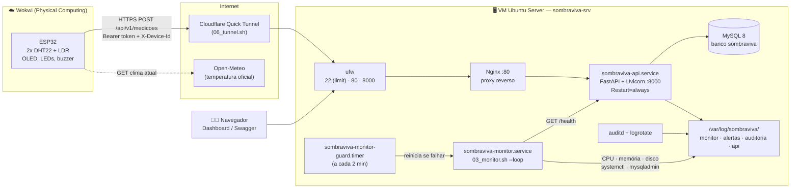

### Como se conecta com as outras disciplinas

| Disciplina | Ligação com este repositório |
|---|---|
| **Physical Computing (IoT)** | O ESP32 do Wokwi faz `POST /api/v1/medicoes` nesta API (mesmo JSON e cabeçalhos do `sketch.ino`). Basta trocar o `API_URL` do sketch pela URL pública do túnel. |
| **SOA / Web Services** | A aplicação hospedada é o backend de SOA ([Global-Solution---2-semestre---Cyber-Soa](https://github.com/JoaoKraideM/Global-Solution---2-semestre---Cyber-Soa)): o `02_provision_app.sh` clona o repositório, roda as migrações Alembic e o seed e sobe a API no systemd. |
| **Cybersecurity** | Autenticação dos dispositivos por token (comparação em tempo constante), **401 + registro de auditoria** em toda tentativa inválida (log + tabela `eventos_auditoria`), firewall, segredos em arquivo `600`, serviços com *hardening* do systemd, auditd e trilha de quem executou cada script. |

## 3. A aplicação hospedada (repositório de SOA)

O código da API **não fica neste repositório**: ele é o entregável de SOA e é clonado pelo `02_provision_app.sh` (`APP_GIT_URL` em `config/app.conf`). Assim, a VM sempre hospeda a mesma API que foi avaliada em SOA.

| Método | Rota | Uso nesta infraestrutura |
|---|---|---|
| `GET` | `/` e `/admin` | Portal climático e central de Cybersecurity |
| `GET` | `/health` | Saúde da API **e do MySQL** (200 = ok, 503 = banco fora). Usado pelo monitor e pelo teste de falha |
| `POST` | `/api/v1/medicoes` | Recebe as medições do ESP32. Exige `Authorization: Bearer <token>` + `X-Device-Id`. Token inválido → **401** e evento de segurança |
| `GET` | `/api/v1/medicoes/resumo` | Diferença Calçadão × zona arborizada e nível de risco atual |
| `GET` | `/docs` | Swagger (documentação automática) |

Enquanto as mudanças não entram na `main` da API, o script aplica em ordem os patches de `patches/` sobre o clone: `0001` (integração ESP32 + VM: `/api/v1/medicoes`, `/health`, migração 004) e `0002` (novo painel e central de segurança com gráficos Apache ECharts servidos localmente). Cada patch é pulado se já estiver no código, então rodar o script de novo é seguro.

O que o `02_provision_app.sh` faz com ela, em ordem: instala Python, MySQL e Nginx → cria banco e usuário com menor privilégio → clona a API e aplica os patches → cria o `venv` → gera `/etc/sombraviva/sombraviva.env` (chmod 600, segredos aleatórios) → `alembic upgrade head` → `python -m app.seed` → serviço systemd → Nginx → health check.

## 4. Requisitos

- **VirtualBox** 7.x (ou VMware/Hyper-V/UTM)
- **ISO Ubuntu Server 26.04 LTS** (ou 24.04 LTS) — <https://ubuntu.com/download/server>
- VM sugerida: **2 vCPU, 2 GB de RAM (4 GB ideal), disco de 20 GB**
- Internet na VM (para `apt` e `pip`)

### Rede da VM no VirtualBox

| Modo | Quando usar | Como acessar da sua máquina |
|---|---|---|
| **Placa em modo Bridge** (recomendado) | Rede de casa/escritório | A VM recebe um IP da sua rede (ex.: `192.168.0.37`). Acesse `http://IP-DA-VM/` ou `http://sombraviva-srv.local/` (mDNS) |
| **NAT + Port Forwarding** | Rede da FIAP / Wi-Fi que bloqueia bridge | Em *Configurações → Rede → Avançado → Redirecionamento de Portas* crie: `SSH 2222 → 22`, `HTTP 8080 → 80`, `API 8000 → 8000`. Acesse `http://localhost:8080/` e `ssh -p 2222 usuario@localhost` |

> Para usar o nome `sombraviva.local` também no seu computador, adicione `IP-DA-VM  sombraviva.local` no arquivo hosts (Windows: `C:\Windows\System32\drivers\etc\hosts`; Linux/macOS: `/etc/hosts`).

## Decisões do projeto (com evidências)

Prints tirados durante a criação e a instalação da VM usada na entrega (pasta [`evidencias/prints/`](evidencias/prints/)).

| Decisão | Por quê | Evidência |
|---|---|---|
| **Ubuntu Server 26.04 LTS, instalação manual** | Versão LTS mais recente; sem interface gráfica para sobrar RAM para MySQL e API. A instalação automática do VirtualBox foi desmarcada porque detectava a ISO como 25.04 | 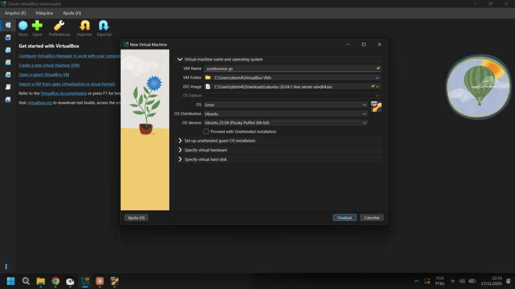 |
| **2 vCPU, 2 GB de RAM, disco de 25 GB** | O notebook tem 8 GB; 2 GB bastam para MySQL + Uvicorn + Nginx, e 2 vCPU permitem mostrar o alerta de CPU sem travar a máquina | 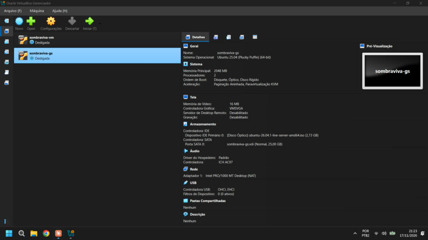 |
| **Rede NAT com redirecionamento de portas** (2222→22, 8080→80) | Funciona em qualquer rede, inclusive na da FIAP, que costuma bloquear o modo Bridge. O Wokwi chega à API pelo túnel (`06_tunnel.sh`), então não precisamos de IP na rede local | 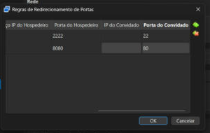 |
| **Hyper-V do Windows desligado** (`bcdedit /set hypervisorlaunchtype off`) | Com o Hyper-V ativo (ícone da tartaruga verde) o VirtualBox travava no boot do kernel em `Loading essential drivers` | 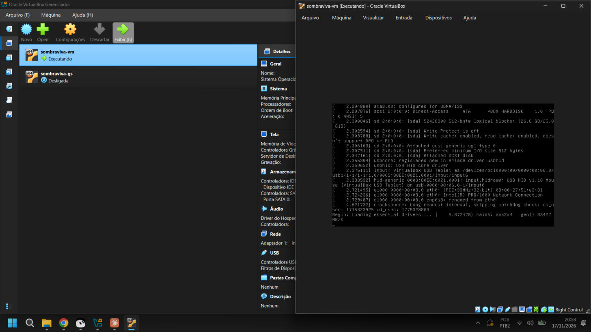 |
| **IP por DHCP** (`USAR_IP_ESTATICO="false"`) | Na NAT do VirtualBox o IP é sempre `10.0.2.15`; fixar IP pelo netplan não traz ganho e pode derrubar o SSH. O script ainda suporta IP fixo para o modo Bridge | 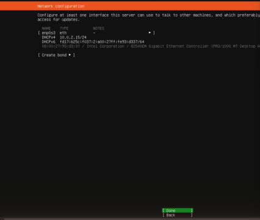 |
| **Espelho oficial do Ubuntu** | Teste de conectividade da VM com a internet antes do provisionamento (apt e pip dependem disso) | 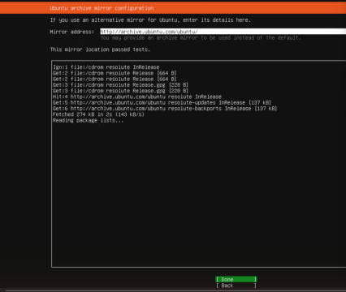 |
| **Disco inteiro com LVM** | O LVM permite aumentar a partição `/` depois (`lvextend`) se os logs crescerem | 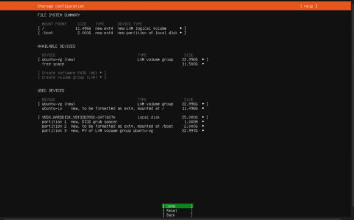 |
| **Hostname `sombraviva-srv`** e usuário administrativo próprio | Mesmo nome definido em `config/infra.conf`; o `01_provision_infra.sh` cria ainda o usuário de serviço `sombraviva` sem shell | 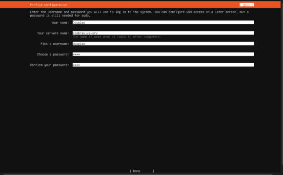 |
| **OpenSSH server** | Administração remota (`ssh -p 2222 douglas@127.0.0.1`); o `ufw` libera a porta 22 com limite contra força bruta | 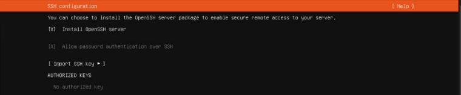 |
| Instalação concluída | — | 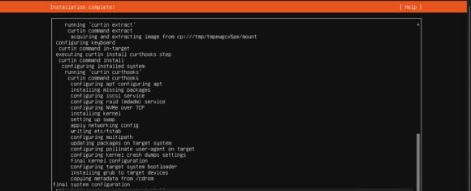 |

## 5. Passo a passo (do zero ao ar em ~20 min)

1. **Crie a VM** no VirtualBox (Linux → Ubuntu 64-bit, 2 vCPU, 2–4 GB, 20 GB) e escolha a rede (seção 4).
2. **Instale o Ubuntu Server** com as opções padrão. Marque **"Install OpenSSH server"**. Usuário sugerido: `fiap`.
3. Entre na VM (pelo console ou `ssh`) e rode:

```bash
sudo apt update && sudo apt install -y git
git clone https://github.com/doug-melo/sombraviva-so.git
cd sombraviva-so
sudo ./provision.sh
```

> Se o repositório foi enviado pelo site do GitHub ou extraído no Windows e aparecer `Permission denied`, rode `sudo bash provision.sh` (ele mesmo aplica `chmod +x` nos scripts).

4. Ao final aparece o **resumo** com URLs, status dos serviços e o health check. Abra no navegador `http://IP-DA-VM/`.
5. Envie medições de teste (sem Wokwi): `./scripts/simular_esp32.sh -n 10 -i 2`
6. Rode os testes de falha: `sudo ./scripts/05_teste_falha.sh`

Opções úteis:

```bash
sudo ./provision.sh --simular      # já envia medições de exemplo no fim
sudo ./provision.sh --sem-rede     # reinstala só app + monitoramento
sudo ./scripts/02_provision_app.sh # cada script também roda sozinho (idempotente)
```

### O que você pode (ou deve) ajustar

| Arquivo | Variável | Para quê |
|---|---|---|
| `config/infra.conf` | `USAR_IP_ESTATICO`, `IP_ESTATICO`, `GATEWAY` | IP fixo (padrão: DHCP, mais seguro) |
| `config/infra.conf` | `DNS_SERVIDORES`, `HOSTNAME_SRV`, `DOMINIO_LOCAL` | DNS e nomes |
| `config/app.conf` | `SOMBRAVIVA_DEVICE_TOKENS` | **Deve bater com `DEVICE_ID`/`DEVICE_TOKEN` do sketch.ino** |
| `config/app.conf` | `DB_PASSWORD` | Vazio = senha forte gerada e reaproveitada |
| `config/monitor.conf` | `CPU_WARN`, `MEM_WARN`, `DISCO_WARN`… | Limites dos alertas |

## 6. Rubrica × arquivos

| Critério (Operating Systems) | Pts | Onde está |
|---|---|---|
| Script de configuração de **rede, DNS e IP** | 2,0 | `scripts/01_provision_infra.sh` + `config/infra.conf` — hostname, `/etc/hosts`, `sombraviva.local`, DNS no systemd-resolved, DHCP ou IP fixo via netplan, mDNS, fuso, **ufw**, usuário de serviço |
| Script de **instalação de dependências e deploy** da aplicação | 2,0 | `scripts/02_provision_app.sh` + `config/app.conf` — apt, MySQL (banco/usuário), venv + pip, `.env` 600, `sombraviva-api.service`, Nginx, health check |
| Script de **monitoramento com alertas** de CPU, disco e memória | 2,0 | `scripts/03_monitor.sh` + `config/monitor.conf` — INFO/WARN/CRIT em `monitor.log`, `alertas.log` e syslog; também checa `/health`, serviços e MySQL |
| Monitoramento como **serviço systemd tolerante a falhas** | 1,0 | `systemd/sombraviva-monitor.service` (`Restart=always`, `RestartSec`, `StartLimit*`, `OOMScoreAdjust`, hardening) + `systemd/sombraviva-monitor-guard.timer` — instalados por `scripts/04_setup_monitoring.sh` |
| **Logs de auditoria** e de execução | 1,0 | `scripts/lib/log.sh` (cada script registra quem/quando/o quê/hash/código de saída em `auditoria.log` + syslog), `auditd/sombraviva.rules`, `logrotate/sombraviva` |
| **Funcionamento completo** (provisionamento automático na VM) | 2,0 | `provision.sh` (comando único) + `scripts/05_teste_falha.sh` + vídeo (`docs/roteiro_video_os.md`) |

## 7. Ligando o Wokwi (ESP32) a esta API

O Wokwi roda na internet e **não enxerga a sua VM**. É preciso uma URL pública:

**Opção A — Cloudflare Quick Tunnel (recomendado, sem conta):**

```bash
sudo ./scripts/06_tunnel.sh
# mostra algo como: https://palavras-aleatorias.trycloudflare.com
```

**Opção B — ngrok** (precisa de conta gratuita e authtoken):

```bash
sudo snap install ngrok        # ou veja https://ngrok.com/download
ngrok config add-authtoken SEU_TOKEN
ngrok http 80
```

Depois, no `sketch.ino` do projeto Wokwi, troque **só** a URL (deixe o túnel aberto enquanto grava):

```cpp
const char* API_URL = "https://palavras-aleatorias.trycloudflare.com/api/v1/medicoes";
const char* DEVICE_ID    = "esp32-osasco-calcadao-01";   // igual ao config/app.conf
const char* DEVICE_TOKEN = "sv-dev-TROQUE-ESTE-TOKEN";    // igual ao config/app.conf
```

No Serial Monitor do Wokwi deve aparecer `[API] ... enviado (HTTP 201)` e as leituras surgem no dashboard. A URL do quick tunnel muda a cada execução.

## 8. Trocando a origem da API

Por padrão a API vem do GitHub (`APP_ORIGEM="git"`, `APP_GIT_URL` em `config/app.conf`). Para usar uma cópia local, defina `APP_ORIGEM="local"` e `APP_FONTE="/caminho/da/api"`. Depois de qualquer mudança: `sudo ./scripts/02_provision_app.sh` (idempotente; reaplica migrações e reinicia o serviço).

## 9. Evidências — onde estão e como mostrar

Todos os logs ficam em **`/var/log/sombraviva/`** (rotacionados diariamente, 14 cópias):

| Arquivo | Conteúdo |
|---|---|
| `provision.log`, `01_…log`, `02_…log`, `04_…log` | Execução de cada script, com data/hora e saída completa dos comandos |
| `auditoria.log` | Quem executou cada script (`SUDO_USER`), quando, onde, argumentos, hash, resultado |
| `monitor.log` | Todas as verificações (CPU, memória, disco, API, serviços, MySQL) |
| `alertas.log` | Só os WARN/CRIT |
| `api.log` | Log da API (inclui `ACESSO_NEGADO` e `ALERTA_CALOR`) |
| `05_teste_falha.log` | Resultado dos testes de falha |

Comandos para o vídeo / prints (salve os prints em `evidencias/`):

```bash
hostnamectl; ip -br a; resolvectl status | head -20; getent hosts sombraviva.local
sudo ufw status verbose
systemctl status sombraviva-api sombraviva-monitor nginx mysql --no-pager
systemctl list-timers sombraviva-monitor-guard.timer
sudo tail -f /var/log/sombraviva/monitor.log
sudo cat /var/log/sombraviva/alertas.log
sudo tail /var/log/sombraviva/auditoria.log
journalctl -t sombraviva-monitor -p warning --since today
journalctl -t sombraviva-audit --since today
sudo ausearch -k sombraviva_config -i | tail -20     # auditd
sudo grep ACESSO_NEGADO /var/log/sombraviva/api.log
curl -s localhost/api/v1/resumo | python3 -m json.tool
sudo stat -c '%A %U %n' /etc/sombraviva/sombraviva.env  # -rw------- root
```

## 10. Estrutura do repositório

```
sombraviva-so/
├── provision.sh                 # comando único: roda tudo em ordem + resumo
├── config/      infra.conf · app.conf · monitor.conf
├── scripts/
│   ├── lib/log.sh               # log colorido + auditoria compartilhados
│   ├── 01_provision_infra.sh    # rede, DNS, IP, firewall, usuário
│   ├── 02_provision_app.sh      # deps, MySQL, venv, systemd, Nginx
│   ├── 03_monitor.sh            # monitoramento (once / loop)
│   ├── 04_setup_monitoring.sh   # serviço do monitor, auditd, logrotate
│   ├── 05_teste_falha.sh        # testes de falha
│   ├── 06_tunnel.sh             # URL pública para o Wokwi (opcional)
│   └── simular_esp32.sh         # envia medições falsas com token
├── systemd/     sombraviva-api.service · sombraviva-monitor.service · guard .service/.timer
├── nginx/sombraviva.conf  ·  auditd/sombraviva.rules  ·  logrotate/sombraviva
├── docs/roteiro_video_os.md     # roteiro do vídeo de 7 min
├── patches/                     # mudanças na API de SOA aplicadas pelo 02 (0001 integração, 0002 painel ECharts)
├── evidencias/                  # prints e logs exportados
└── prompts.md                   # registro dos prompts de IA (regra da GS)
```

## 11. Validação local dos scripts (sem VM)

```bash
shellcheck -x -P scripts provision.sh scripts/*.sh          # análise estática dos scripts
LOG_DIR=/tmp/svlogs HEALTH_URL=http://localhost:8000/health ./scripts/03_monitor.sh   # com a API de SOA rodando localmente
./scripts/simular_esp32.sh -u http://localhost:8000
```

## 12. Boas práticas e regras da GS

- Somente **dados simulados**: nenhum dado pessoal real é coletado.
- Segredos (senha do banco, tokens) **nunca** vão para o Git — ficam em `/etc/sombraviva/sombraviva.env` (`chmod 600`).
- Uso de IA registrado em [`prompts.md`](prompts.md).
- ODS 3, 11 e 13.
